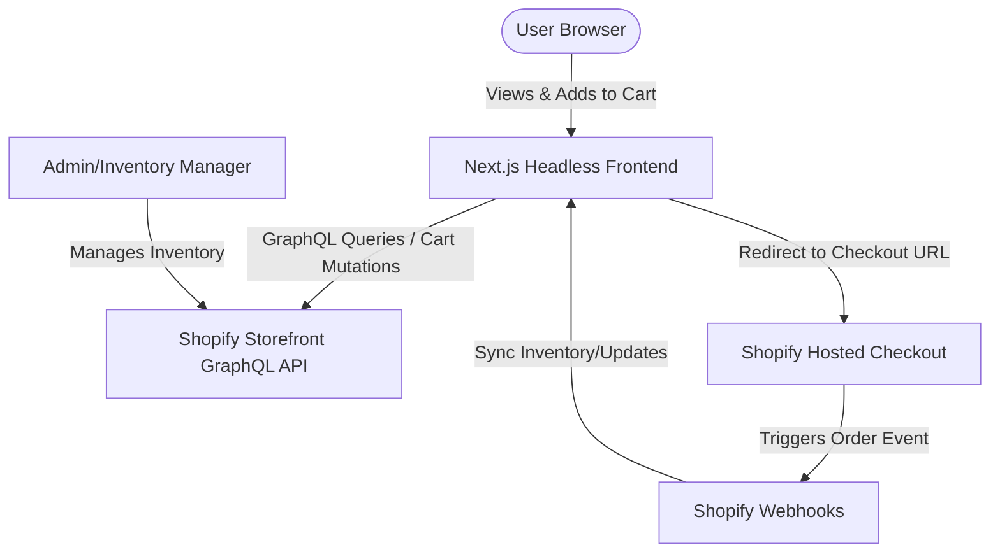

# Shopify Headless Integration Guide: Architecture & Architecture Context

This document provides a comprehensive overview of building a headless e-commerce store using **Next.js** and **Shopify Storefront API**. It details how the integration works, structural limitations, technical challenges, and the recommended technology stack.

---

## 1. How It Works: Headless Shopify Context

In a headless architecture, Shopify is decoupled from the frontend. 
- **Shopify Admin** is used solely as a headless content management system (CMS), inventory manager, and checkout engine.
- **Next.js** handles the user interface, routing, page generation, and client-side interactions.

### Flow of Core Interactions:
1. **Catalog Retrieval**: Next.js fetches product details, collections, and pricing at build time (Static Site Generation - SSG) or on-demand (Incremental Static Regeneration - ISR) from the **Shopify Storefront GraphQL API**.
2. **Cart Management**: The cart is created and updated using Shopify's Storefront Cart API. A unique `cartId` is stored in the user's browser cookie or local storage. Add/Remove actions execute GraphQL mutations directly on Shopify.
3. **The Checkout**: When the user clicks "Checkout", the frontend requests the `checkoutUrl` from Shopify's Cart object and redirects the user's browser to Shopify's secure, hosted checkout page (e.g., `checkout.shopify.com` or a custom sub-domain like `checkout.yourbrand.com`).
4. **Order Completion**: After a successful checkout, Shopify processes the payment and redirects the user back to a custom thank-you/receipt page on the Next.js site.

---

## 2. Technical Stack for Implementation

To build a high-performance, robust frontend, we recommend the following stack:

- **Framework**: **Next.js 14+ (App Router)**
  - Enables React Server Components (RSC) to fetch product data on the server, resulting in zero-bundle-size GraphQL requests.
  - Supports API Routes to handle secure server-side communications (e.g., revalidation webhooks).
- **API Communication**: **GraphQL & Shopify Storefront API SDK**
  - Shopify's Storefront API is GraphQL-first. Using `@shopify/hydrogen-react` or raw GraphQL queries ensures minimal data transmission and typing accuracy.
- **Client State**: **React Context / Zustand**
  - Used to manage local cart slide-overs, user menus, and search overlay states.
- **Styling**: **CSS Modules / Vanilla CSS**
  - Keeps the styles modular, lightweight, and fast, aligning with our premium design guidelines.
- **Deployment**: **Vercel or Netlify**
  - Essential for hosting Next.js. Supports Edge middleware, static optimization, and global CDN delivery.

---

## 3. Limitations of Headless Shopify

When bypassing Shopify's Liquid themes, certain native Shopify features require custom workarounds:

| Feature | Liquid (Monolithic) | Next.js (Headless) | Impact / Mitigation |
| :--- | :--- | :--- | :--- |
| **Checkout Page** | Highly customizable (Shopify Plus) | Standard Shopify Checkout | Standard plans cannot style the checkout page beyond uploading a logo and changing colors. All headless setups must redirect to the Shopify-hosted URL. |
| **App Store Plugins** | Click-to-install (e.g., reviews, discounts) | Require APIs or SDKs | Many Shopify Apps rely on script injection into Liquid themes. In headless, you must implement these features via React components and admin APIs. |
| **Multi-Currency / Markets** | Automatic localization | Manual Storefront API mapping | Next.js must detect user location (via IP or headers) and pass the appropriate localization context (buyer IP, country code) to the Storefront API. |
| **Discount Codes** | Applied in cart or checkout | Must pass to Cart mutation | Coupons can be entered on the Next.js side and applied directly to the Shopify Cart object before redirecting to checkout. |

---

## 4. Key Technical Challenges & Solutions

### A. API Rate Limiting (Throttling)
- **Challenge**: Shopify limits Storefront API requests based on user IP address (buyer IP) or API client limits. Under heavy traffic, client-side fetches can hit limits.
- **Solution**: Leverage **Next.js Server Components** and cache queries using `fetch(..., { next: { revalidate: 3600 } })`. Execute product catalog queries on the server and only use client-side calls for dynamic inventory check and cart mutations.

### B. Cart & Inventory Desynchronization
- **Challenge**: If a product goes out of stock after a user adds it to their cart but before they check out, checkout might fail or show errors.
- **Solution**: Query the stock status of items in the cart on the Next.js checkout button click. Disable the checkout button and show a visual alert if items have become unavailable.

### C. Search Engine Optimization (SEO) & Metadata
- **Challenge**: Headless stores can lose default Shopify SEO features (Sitemaps, JSON-LD schema, canonical URLs).
- **Solution**: Use Next.js dynamic metadata APIs (`generateMetadata`). Generate a dynamic `sitemap.xml` using a Next.js route handler that fetches all active product and collection handles from Shopify.

### D. Webhooks for Revalidation
- **Challenge**: Keeping static product pages updated when inventory or descriptions change in Shopify Admin.
- **Solution**: Create a Next.js API Route (`/api/revalidate`) that listens for Shopify Admin Webhooks (e.g., `product/update`). When Shopify alerts Next.js of a change, trigger `revalidatePath` or `revalidateTag` to purge the CDN cache instantly.
